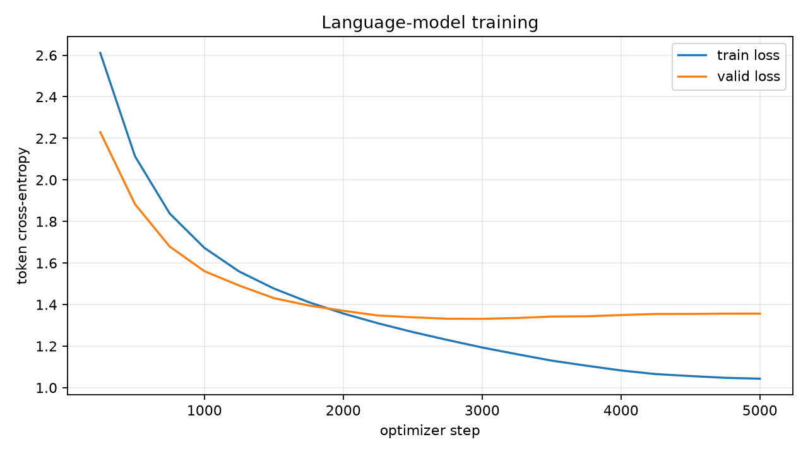

# Kaggle Tiny Shakespeare 训练记录

[Kaggle 训练指南](../guides/kaggle.zh-CN.md) | [参考配置](../../configs/kaggle_char_small.yaml) | [项目首页](../../README.zh-CN.md)

这是项目发布的首次完整训练结果。Kaggle kernel version 2 于 2026-08-22 在 Tesla T4 上完成 5,000 updates，使用验证集选出的 step 3000 `best.pt` 一次性评估 test split。

- 页面：<https://www.kaggle.com/code/yashowhoo/pytorch-language-modeling-lab-gpu>
- 模型：6 层 decoder-only Transformer，384 hidden，6 heads，256 context。
- 参数量：10,763,136。
- tokenizer：字符级，69 tokens。
- 数据：Tiny Shakespeare，按 7,148 个去重文档切分。

## 结果

| 项目 | 数值 |
| --- | ---: |
| 完成 updates | 5,000 |
| 最佳 step | 3,000 |
| 最佳验证 loss | **1.331334** |
| 最佳验证 perplexity | **3.786090** |
| 测试 loss | **1.339164** |
| 测试 perplexity | **3.815852** |
| 有效训练 target tokens | 39,238,634 |
| 最终吞吐 | 46,995.7 token/s |
| 训练时间 | 835.2 秒，约 13 分 55 秒 |
| 完整 pipeline | 881.3 秒，约 14 分 41 秒 |
| 峰值 CUDA 显存 | 2,780,630,528 bytes，约 2.59 GiB |



训练 loss 持续下降；验证 loss 在 step 3000 达到最低点，之后缓慢上升，因此最终评估使用 `best.pt`，不是 step 5000 的 `last.pt`。

## 固定 Prompt

配置使用 temperature `0.8`、top-k `40`、top-p `0.95`、seed `42` 和 KV cache。固定 prompt `The ` 的保存输出是：

```text
The Lord:
This is god sickness in the house.
```

它在 41 个新 token 后生成 EOS。单个样例只用于检查生成链路和 checkpoint，不代表事实性、稳定性或模型总体质量。原始 token ids 与生成参数见 [`evaluation/prompts.jsonl`](evaluation/prompts.jsonl)。

## 数据

| split | 文档 | tokens | windows |
| --- | ---: | ---: | ---: |
| train | 6,433 | 1,002,843 | 8,090 |
| valid | 357 | 59,422 | 466 |
| test | 358 | 52,065 | 442 |

源文件 1,115,394 bytes，SHA-256 为 `86c4e6aa...565ed`。manifest identity 为 `cb49ae60...5a1c`，tokenizer fingerprint 为 `2f21f34c...af3e`。完整轻量摘要见 [`data-summary.json`](data-summary.json)。

## 环境

- Python 3.12.13。
- PyTorch 2.10.0+cu128，CUDA 12.8。
- Tesla T4，compute capability 7.5；Kaggle 提供 2 张，本项目只使用 `cuda:0`。
- CUDA 总显存 15,636,037,632 bytes。
- AMP 开启，batch 64，AdamW，200 steps warmup + cosine decay。

精确字段见 [`environment.json`](environment.json) 和实际解析的 [`config.yaml`](config.yaml)。

## 身份与可验证文件

| 项目 | SHA-256 |
| --- | --- |
| 自包含源码快照 | `04f4cefa7483fb984822917e06af8d16115565f5b25d270d0d48f23afbf7006f` |
| 被评估 `best.pt` | `c00c1cbaa5761640134c148695f09ece4f4bc299cb337d0a6aa029841b8af4ba` |
| 最终 `last.pt` | `fb739e3d5dd0eebb178c77f9daaaf1765685971e294dad1f5e935fcb9cd6c05a` |

仓库同时冻结了完成该任务的历史 kernel version 2 源码证据：[kernel-v2/](kernel-v2/)。当前目录下的 `kaggle/run_kaggle.py` 是按最新源码重建的未来提交 runner，hash 不必与历史记录相同。

仓库保留以下轻量证据：

- [`metrics.csv`](metrics.csv)：20 次验证记录。
- [`evaluation/summary.json`](evaluation/summary.json)：best checkpoint 的 valid/test 指标。
- [`kaggle-run-summary.json`](kaggle-run-summary.json)：训练耗时、资源和最终指标。
- [`run.json`](run.json)：kernel、源码快照和 checkpoint 身份。

两个 checkpoint 各约 123 MiB，不提交 Git。需要模型时从 Kaggle kernel version 2 的输出下载。

## 失败记录

Kernel version 1 被分配 Tesla P100 (`sm_60`)，而 Kaggle 当前 PyTorch 只包含 `sm_70+` CUDA kernels，训练启动时报 `no kernel image is available`。Version 2 在 metadata 请求 T4，并增加 compute capability preflight 后完成。这也是仓库保留设备兼容性检查的原因。
