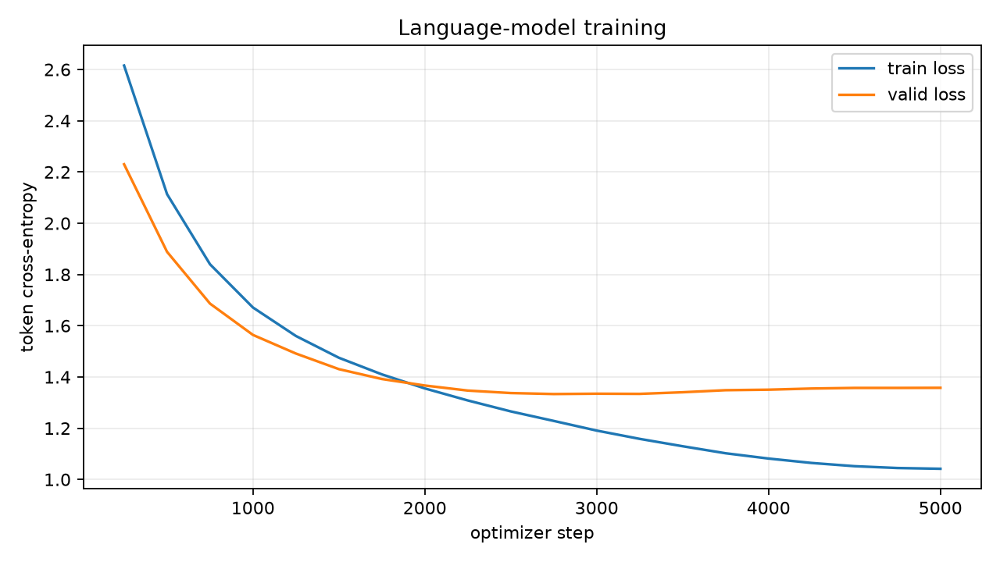

# Kaggle v2 训练记录

这是优化后 `0.2.0` 代码的第一次完整真实训练。使用 Kaggle kernel version 3、Tesla T4、可读版 attention、checkpoint schema v2、确定性批顺序、按有效 token 加权的训练逻辑，以及新增的 accuracy/BPC/BPB 指标。

- Kaggle 页面：<https://www.kaggle.com/code/yashowhoo/pytorch-language-modeling-lab-gpu>
- Kernel version：3
- 源码版本：`0.2.0`
- 源码快照：`a506d0cb60901264f248a1922368c4713eadc8ebbd4139e71a57999b66a76edf`，140,563 bytes
- Manifest identity：`3059ee14b15d07394999ce01c0fec50398207999c13efbeea92dba8da2ca12b0`
- Tokenizer fingerprint：`2f21f34c3e7146a043097c9d5c3e97a16de8d280f7e3a97fee031300ae5baf3e`

## 结果

| 指标 | 数值 |
| --- | ---: |
| 完成 updates | 5,000 |
| 最佳 step | 2,750 |
| 最佳验证 loss | 1.333396 |
| 最佳验证 perplexity | **3.793904** |
| 测试 loss | 1.342340 |
| 测试 perplexity | **3.827989** |
| 测试 top-1 accuracy | 0.586632 |
| 测试 top-5 accuracy | 0.870946 |
| 测试 bits-per-character | 1.950089 |
| 有效训练 target tokens | 39,229,485 |
| 最终吞吐 | 41,735.7 token/s |
| 训练时间 | 940.2 秒 |
| 峰值 CUDA 显存 | 2,829,815,296 bytes，约 2.64 GiB |

旧 recorded run 的验证 perplexity 为 3.786090，测试 perplexity 为 3.815852。本次运行使用了新的 PyTorch/CUDA 环境和新的训练实现，差异较小但属于新的基线，不能仅凭一次运行宣称回归或提升。

## Readable 与 SDPA 对照

在相同 `0.2.0` 配置下，使用 PyTorch SDPA 完成 attention 实现对照。SDPA 用时 666.0 秒，吞吐 58,921.9 token/s，峰值 CUDA 显存约 1.66 GiB；readable 版本用时 940.2 秒，吞吐 41,735.7 token/s，峰值显存约 2.64 GiB。测试 perplexity 分别为 3.818914 和 3.827989，测试 top-1 分别为 0.590230 和 0.586632。详见 [SDPA 对照记录](sdpa/README.zh-CN.md)。

在相同 `0.2.0` 配置下，使用 RoPE positional encoding 的 SDPA 运行 test perplexity 为 **3.570483**、top-1 为 **0.606417**，learned + SDPA 对照分别为 3.818914 和 0.590230。RoPE 吞吐较低，为 50,160.6 token/s。详见 [RoPE 对照记录](rope/README.zh-CN.md)。

- [`environment.json`](environment.json)：Python、PyTorch、CUDA、GPU、依赖和确定性设置。
- [`manifest.json`](manifest.json)：数据身份和 split 元数据。
- [`metrics.csv`](metrics.csv)：20 次验证记录，包含 top-1/top-5 accuracy。
- [`evaluation/summary.json`](evaluation/summary.json)：`best.pt` 的 valid/test 指标。
- [`evaluation/prompts.jsonl`](evaluation/prompts.jsonl)：固定 prompt 和生成结果。
- [`comparison.json`](comparison.json)：相同数据身份下 readable/SDPA/RoPE 对照的机器可读结果。

checkpoint 二进制文件不提交 Git。需要模型时从 kernel version 3 下载 `artifacts/kaggle-char-small/checkpoints/best.pt` 或 `last.pt`，并使用 [`provenance.json`](provenance.json) 校验 hash。
